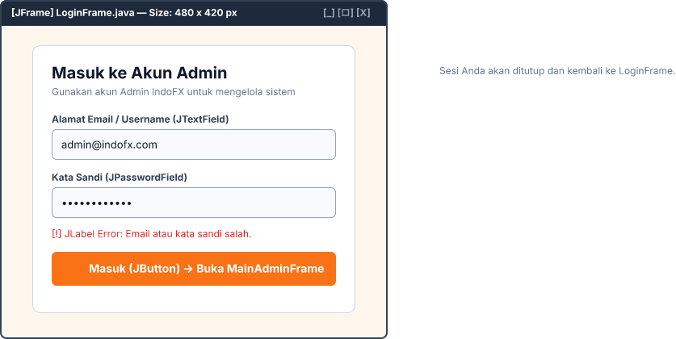
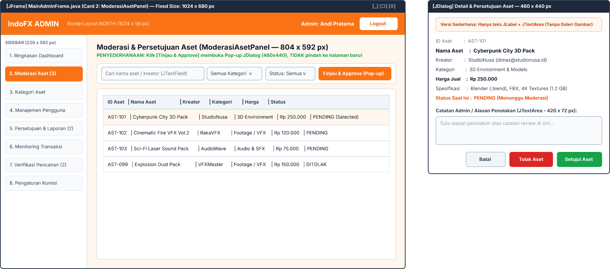
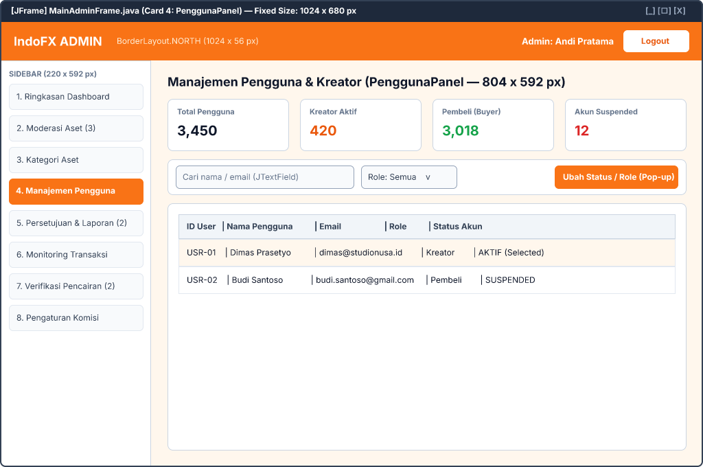
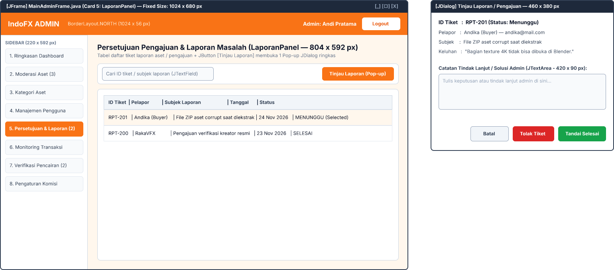
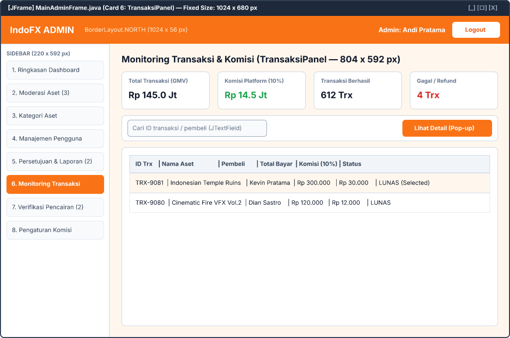
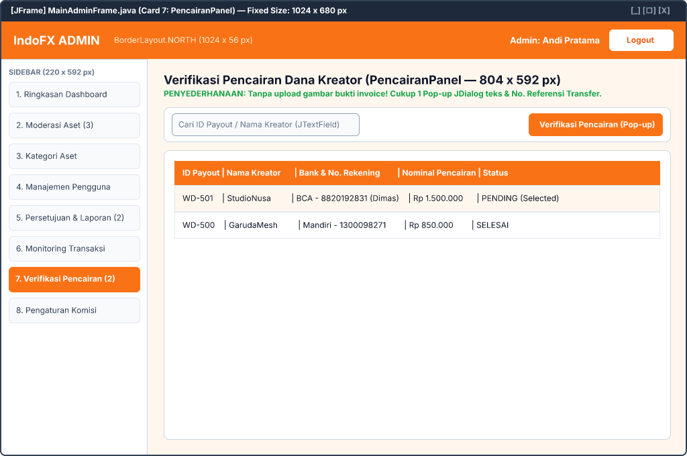
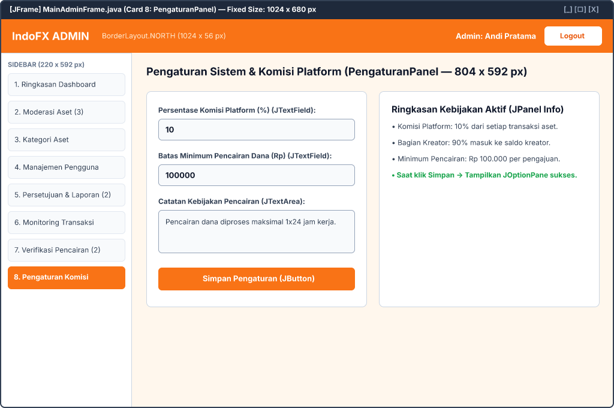

# IndoFX Admin — Aplikasi Desktop Java Swing (NetBeans Java Ant)

Repository ini adalah **base project Panel Admin IndoFX** menggunakan **Apache NetBeans (Java with Ant)** dan **Java Swing** untuk dikerjakan bersama tim melalui **GitHub**.

> **Status Saat Ini:** Fokus pada **Front-End (UI Java Swing)** terlebih dahulu. Logika Back-End & Database akan menyusul setelah seluruh halaman selesai.

---

## Daftar Isi
1. [Step-by-Step: Membuka & Menjalankan Project di NetBeans](#1-step-by-step-membuka--menjalankan-project-di-netbeans)
2. [Struktur Folder & Aturan Pembagian Tugas Tim (Anti-Bentrok)](#2-struktur-folder--aturan-pembagian-tugas-tim-anti-bentrok)
3. [Step-by-Step: Membuat Halaman Baru dengan Drag & Drop (`JFrame Form`)](#3-step-by-step-membuat-halaman-baru-dengan-drag--drop-jframe-form)
4. [Standar Ukuran Window & Palet Warna (Wajib Konsisten)](#4-standar-ukuran-window--palet-warna-wajib-konsisten)
5. [Step-by-Step: Cara Kerja Tim di GitHub (Pull, Commit, Push)](#5-step-by-step-cara-kerja-tim-di-github-pull-commit-push)
6. [Rancangan Wireframe Lengkap (Per Halaman & Pop-up)](#6-rancangan-wireframe-lengkap-per-halaman--pop-up)

---

## 1. Step-by-Step: Membuka & Menjalankan Project di NetBeans

### Langkah 1: Pastikan Software Terpasang
- **JDK** (minimal **JDK 17**, mendukung JDK 17 / 21 / 25 / 27).
- **Apache NetBeans** (disarankan NetBeans versi terbaru).

### Langkah 2: Clone Repository dari GitHub
Pilih salah satu cara berikut:
- **Cara A (Lewat NetBeans):**
  1. Buka NetBeans, klik menu **`Team` → `Git` → `Clone...`**.
  2. Masukkan **Repository URL** dari GitHub tim Anda.
  3. Klik **Next** → pilih branch **`main`** (atau `master`) → **Next** → **Finish**.
  4. Saat muncul dialog *"Clone Completed"*, klik **`Open Project`**.
- **Cara B (Lewat Terminal / GitHub Desktop):**
  ```bash
  git clone <URL_REPO_GITHUB_TIM>
  ```
  Lalu di NetBeans klik **`File` → `Open Project...`** (ikon folder dengan cangkir kopi) dan pilih folder hasil clone.

### Langkah 3: Mengatasi Error "Broken Platform" (Jika Muncul)
Jika di laptop teman muncul tanda seru merah atau pesan *"Resolve Project Problems"* karena perbedaan versi JDK:
1. **Klik kanan** nama project (`IndoFX_Admin`) di panel kiri (*Projects*).
2. Pilih **`Properties`**.
3. Klik **`Libraries`** → pada bagian **Java Platform**, pilih JDK yang terpasang di laptop Anda.
4. Klik **`Sources`** → pastikan **Source/Binary Format** tetap **`JDK 17`** (agar tetap kompatibel dengan semua anggota tim).
5. Klik **OK**.

### Langkah 4: Jalankan Contoh Project (`DashboardFrame`)
- Untuk menjalankan project utama: tekan **`F6`** (atau klik tombol **Play hijau** di toolbar).
- Untuk menjalankan satu file saja: klik kanan **`DashboardFrame.java`** → pilih **`Run File`** (atau tekan **`Shift + F6`**).

---

## 2. Struktur Folder & Aturan Pembagian Tugas Tim (Anti-Bentrok)

Semua file kode sumber diletakkan di dalam package **`src/indofx/admin/`**.

> **ATURAN WAJIB KERJA TIM:**
> 1. **1 Orang = 1 Halaman (`JFrame Form`).** Jangan pernah mengedit file `.java` / `.form` milik teman lain agar tidak terjadi *merge conflict*!
> 2. **Selalu Commit `.java` dan `.form` bersamaan.** Jika Anda membuat `JFrame Form` lewat drag-and-drop NetBeans, akan muncul 2 file (contoh: `ModerasiAsetFrame.java` dan `ModerasiAsetFrame.form`). Keduanya wajib di-commit!
> 3. **Jangan pernah commit `nbproject/private/`.** Folder ini sudah otomatis diabaikan oleh `.gitignore`.

```text
.
├── build.xml                               # Konfigurasi build Java Ant NetBeans
├── manifest.mf                             # Manifest aplikasi Java
├── nbproject/
│   ├── build-impl.xml                      # Script Ant bawaan NetBeans (jangan diedit manual)
│   ├── project.properties                  # Pengaturan JDK 17 & Main Class
│   └── project.xml                         # Identitas project NetBeans
├── docs/
│   └── wireframe/                          # File desain & gambar Wireframe lengkap
│       ├── indofx-admin-wireframe.figcraft # File sumber desain FigCraft
│       ├── wireframe-interaktif.html       # Simulasi wireframe HTML interaktif (buka di browser)
│       ├── full-wireframe.png              # Gambar keseluruhan kanvas wireframe
│       ├── 00-login-dan-panduan.png
│       ├── 01-dashboard.png
│       ├── 02-moderasi-aset.png
│       ├── 03-kategori-aset.png
│       ├── 04-manajemen-pengguna.png
│       ├── 05-laporan-masalah.png
│       ├── 06-monitoring-transaksi.png
│       ├── 07-verifikasi-pencairan.png
│       └── 08-pengaturan-komisi.png
└── src/
    └── indofx/
        └── admin/                          # <--- SEMUA FILE JAVA & .FORM DI SINI
            ├── Main.java                   # Entry point utama aplikasi
            ├── DashboardFrame.java         # [CONTOH BASE] Menu 1: Ringkasan Dashboard
            ├── LoginFrame.java/.form       # (Tugas Tim) Layar Login (480 x 420 px)
            ├── ModerasiAsetFrame.java/.form# (Tugas Tim) Menu 2: Moderasi & Approve Aset
            ├── KategoriFrame.java/.form    # (Tugas Tim) Menu 3: Manajemen Kategori Aset
            ├── PenggunaFrame.java/.form    # (Tugas Tim) Menu 4: Manajemen Pengguna
            ├── LaporanFrame.java/.form     # (Tugas Tim) Menu 5: Persetujuan & Laporan Masalah
            ├── TransaksiFrame.java/.form   # (Tugas Tim) Menu 6: Monitoring Transaksi & Komisi
            ├── PencairanFrame.java/.form   # (Tugas Tim) Menu 7: Verifikasi Pencairan Dana
            └── PengaturanFrame.java/.form  # (Tugas Tim) Menu 8: Pengaturan Komisi Platform
```

---

## 3. Step-by-Step: Membuat Halaman Baru dengan Drag & Drop (`JFrame Form`)

Ikuti langkah berikut di NetBeans saat membuat halaman tugas Anda:

1. **Buat File `JFrame Form` Baru:**
   - Di panel kiri **Projects**, buka `Source Packages` → klik kanan **`indofx.admin`**.
   - Pilih **`New` → `JFrame Form...`**.
   - Isi **Class Name** sesuai tabel di atas (contoh: `ModerasiAsetFrame`), lalu klik **Finish**.
2. **Atur Ukuran Window Standar (`1024 x 680 px`):**
   - Klik area kosong `JFrame` pada tab **Design** (atau klik `JFrame` di panel **Navigator** kiri bawah).
   - Di panel **Properties** (kanan):
     - Set **`preferredSize`** → `[1024, 680]`
     - Hilangkan centang pada **`resizable`** (`false`)
   - Pada tab **Code** di Properties: centang **`Generate Center`** (agar window muncul di tengah layar).
3. **Susun 3 Area Utama (Bisa pakai `BorderLayout` atau `Free Design`):**
   - **Navbar Atas (`JPanel`):** Ukuran `1024 x 56 px`, warna background Oranye (`249, 115, 22`). Isi dengan `JLabel` "IndoFX ADMIN", nama admin, dan `JButton` "Logout".
   - **Sidebar Kiri (`JPanel`):** Ukuran `220 x 592 px`, warna background Putih (`255, 255, 255`). Isi dengan 8 `JButton` menu (`196 x 38 px`). Beri warna Oranye (`249, 115, 22`) + teks putih hanya pada tombol menu yang sedang aktif!
   - **Konten Utama (`JPanel`):** Ukuran `804 x 592 px`, warna background Cream (`255, 247, 237`). Isi dengan judul, filter bar, dan `JScrollPane` + `JTable`.
4. **Buat Pop-up Sederhana (`JDialog Form` atau `JOptionPane`):**
   - **Untuk Pop-up Detail / Form:** Klik kanan `indofx.admin` → **`New` → `JDialog Form...`** (beri nama misal `DetailAsetDialog.java`), atur ukuran `460 x 440 px` (atau `460 x 380 px`), lalu panggil dari tombol di halaman utama:
     ```java
     DetailAsetDialog dialog = new DetailAsetDialog(this, true); // true = modal
     dialog.setLocationRelativeTo(this);
     dialog.setVisible(true);
     ```
   - **Untuk Pop-up Konfirmasi Hapus / Logout:** Cukup gunakan 1 baris `JOptionPane.showConfirmDialog(...)` seperti di [`DashboardFrame.java`](src/indofx/admin/DashboardFrame.java).

> **Catatan:** Anda bisa menjalankan [`DashboardFrame.java`](src/indofx/admin/DashboardFrame.java) (`Shift + F6`) kapan saja untuk melihat contoh hasil jadi tampilannya!

---

## 4. Standar Ukuran Window & Palet Warna (Wajib Konsisten)

### Ukuran Window & Komponen
| Komponen / Window | Ukuran (`Width x Height`) | Keterangan |
| :--- | :--- | :--- |
| **Window Login** (`LoginFrame`) | **`480 x 420 px`** | Card login putih di tengah (`400 x 332 px`) |
| **Window Utama Admin (Menu 1–8)** | **`1024 x 680 px`** | `resizable = false` |
| ↳ **Navbar Atas** | **`1024 x 56 px`** | Bagian atas window |
| ↳ **Sidebar Kiri** | **`220 x 592 px`** | Berisi 8 tombol menu (`196 x 38 px`) |
| ↳ **Area Konten Utama** | **`804 x 592 px`** | Tempat judul, kartu statistik, filter, & `JTable` |
| **Pop-up Detail / Form Input** (`JDialog`) | **`420..460 x 250..440 px`** | Muncul di tengah saat tombol aksi diklik |
| **Pop-up Konfirmasi** (`JOptionPane`) | **`360 x 200 px`** | Konfirmasi Logout & Hapus |

### Palet Warna (Siap Ketik di Properties NetBeans)
Di panel **Properties → background / foreground** NetBeans, klik `...` lalu pilih tab **RGB** dan masukkan angka berikut:

| Kegunaan | Hex | Nilai RGB (NetBeans) |
| :--- | :--- | :--- |
| **Oranye Utama** (Navbar & Menu Aktif & Tombol Utama) | `#F97316` | `249, 115, 22` |
| **Oranye Gelap** (Teks Tombol Logout / Aksen) | `#EA580C` | `234, 88, 12` |
| **Cream** (Background Area Konten Utama) | `#FFF7ED` | `255, 247, 237` |
| **Putih** (Background Sidebar, Card, & Pop-up) | `#FFFFFF` | `255, 255, 255` |
| **Abu-abu Muda** (Tombol Menu Tidak Aktif & Header Tabel) | `#F8FAFC` / `#F1F5F9` | `248, 250, 252` / `241, 245, 249` |
| **Teks Gelap** (Judul & Isi Tabel) | `#0F172A` | `15, 23, 42` |
| **Hijau** (Tombol Setujui / Status Selesai) | `#16A34A` | `22, 163, 74` |
| **Merah** (Tombol Tolak / Hapus) | `#DC2626` | `220, 38, 38` |

---

## 5. Step-by-Step: Cara Kerja Tim di GitHub (Pull, Commit, Push)

### A. Sebelum Mulai Ngoding (Wajib Pull!)
1. Di NetBeans, **klik kanan** project `IndoFX_Admin`.
2. Pilih **`Git` → `Remote` → `Pull...`**.
3. Pastikan tidak ada error agar kode Anda sinkron dengan kerjaan teman terbaru.

### B. Setelah Selesai Membuat / Mengubah File
1. Pastikan project **tidak ada error merah** (`Clean and Build` atau tekan **`Shift + F11`**).
2. **Klik kanan** project `IndoFX_Admin` → **`Git` → `Commit...`**.
3. Periksa daftar file yang akan di-commit:
   - Pastikan hanya file tugas Anda (`.java` dan `.form`) yang tercentang.
   - Jangan centang file milik teman lain jika tidak sengaja tersentuh.
4. Tulis pesan commit yang jelas (contoh: `Menambahkan UI ModerasiAsetFrame dan DetailAsetDialog`), lalu klik **Commit**.
5. **Klik kanan** project → **`Git` → `Remote` → `Push...`** → ikuti hingga **Finish**.

> **Tips Login GitHub di NetBeans:**
> Saat diminta **Password** ketika Push/Pull, **jangan isi password akun GitHub**, melainkan isi dengan **Personal Access Token (PAT)** dari GitHub (`Settings → Developer settings → Personal access tokens → Tokens (classic)`).
> *Alternatif:* Jika dirasa lebih nyaman, Anda boleh melakukan Pull/Commit/Push lewat aplikasi **GitHub Desktop** sementara kodingnya tetap di **NetBeans**.

---

## 6. Rancangan Wireframe Lengkap (Per Halaman & Pop-up)

* **File Sumber FigCraft:** [`docs/wireframe/indofx-admin-wireframe.figcraft`](docs/wireframe/indofx-admin-wireframe.figcraft)
* **Prototype HTML Interaktif (Bisa diklik di Browser):** [`docs/wireframe/wireframe-interaktif.html`](docs/wireframe/wireframe-interaktif.html)
* **Gambar Keseluruhan Kanvas:** [`docs/wireframe/full-wireframe.png`](docs/wireframe/full-wireframe.png)

### 0. Layar Login (`LoginFrame.java` — `480 x 420 px`) & Konfirmasi Logout (`360 x 200 px`)


---

### 1. Menu 1 — Ringkasan Dashboard (`DashboardFrame.java` — *CONTOH SUDAH JADI*)
* **Window Utama:** `1024 x 680 px` (4 Kartu Statistik + `JTable` Antrean Moderasi Terbaru)
* **Pop-up (`JDialog`):** `420 x 250 px` (Konfirmasi Cepat Moderasi: Input Alasan + Tombol Batal / Tolak / Setujui)


---

### 2. Menu 2 — Moderasi & Persetujuan Aset (`ModerasiAsetFrame`)
* **Penyederhanaan:** **Tidak pindah halaman & tanpa galeri gambar.** Klik tombol `[Tinjau & Approve (Pop-up)]` di atas tabel langsung membuka 1 `JDialog`.
* **Window Utama:** `1024 x 680 px` (Filter Bar: `JTextField` Cari, `JComboBox` Kategori & Status, `JButton` Tinjau + `JTable`)
* **Pop-up (`JDialog`):** `460 x 440 px` (Label Teks Detail Aset + `JTextArea` Catatan/Alasan Penolakan + Tombol Batal / Tolak Aset / Setujui Aset)


---

### 3. Menu 3 — Manajemen Kategori Aset (`KategoriFrame`)
* **Window Utama:** `1024 x 680 px` (3 Tombol Aksi: `[+ Tambah Kategori]`, `[Edit Baris Terpilih]`, `[Hapus Baris Terpilih]` + `JTable`)
* **Pop-up Form (`JDialog`):** `420 x 320 px` (`JTextField` Nama Kategori, `JTextField` Kode/Slug, `JComboBox` Status)
* **Pop-up Hapus (`JOptionPane`):** `360 x 200 px` (Konfirmasi hapus kategori)


---

### 4. Menu 4 — Manajemen Pengguna & Kreator (`PenggunaFrame`)
* **Window Utama:** `1024 x 680 px` (4 Kartu Statistik + Filter Bar + `JTable` Daftar Pengguna)
* **Pop-up (`JDialog`):** `420 x 340 px` (Teks Nama & Email + `JComboBox` Pilih Role + `JComboBox` Status Akun Aktif/Suspended)


---

### 5. Menu 5 — Persetujuan Pengajuan & Laporan Masalah (`LaporanFrame`)
* **Window Utama:** `1024 x 680 px` (Filter Bar + `JTable` Daftar Tiket Laporan)
* **Pop-up (`JDialog`):** `460 x 380 px` (Detail Tiket & Keluhan + `JTextArea` Catatan Solusi Admin + Tombol Batal / Tolak Tiket / Tandai Selesai)


---

### 6. Menu 6 — Monitoring Transaksi & Komisi (`TransaksiFrame`)
* **Window Utama:** `1024 x 680 px` (4 Kartu Statistik Pendapatan + Filter Bar + `JTable` Riwayat Transaksi)
* **Pop-up (`JDialog`):** `440 x 340 px` (Rincian Teks ID Transaksi, Pembeli, Kreator, Harga Aset, Potongan Komisi 10%, dan Pendapatan Bersih Kreator)


---

### 7. Menu 7 — Verifikasi Pencairan Dana Kreator (`PencairanFrame`)
* **Penyederhanaan:** **Tanpa upload file gambar bukti invoice transfer.**
* **Window Utama:** `1024 x 680 px` (Filter Bar + `JTable` Daftar Pengajuan Pencairan)
* **Pop-up (`JDialog`):** `460 x 380 px` (Informasi Kreator, Rekening Bank, Nominal Transfer + `JTextField` No. Referensi Transfer / Catatan Admin + Tombol Batal / Tolak Dana / Konfirmasi Selesai)


---

### 8. Menu 8 — Pengaturan Sistem & Komisi Platform (`PengaturanFrame`)
* **Window Utama:** `1024 x 680 px` (2 `JPanel` berdampingan: Card Kiri berisi form input `% Komisi Platform`, `Minimum Pencairan (Rp)`, `Catatan Kebijakan`, dan tombol `[Simpan Pengaturan]`; Card Kanan berisi teks ringkasan aturan aktif).

