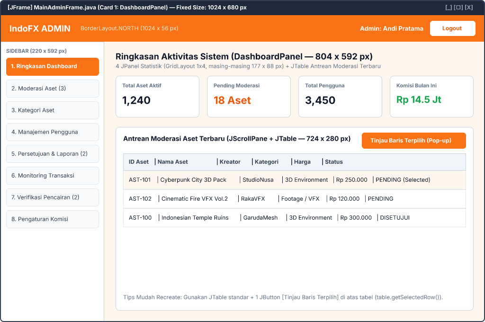
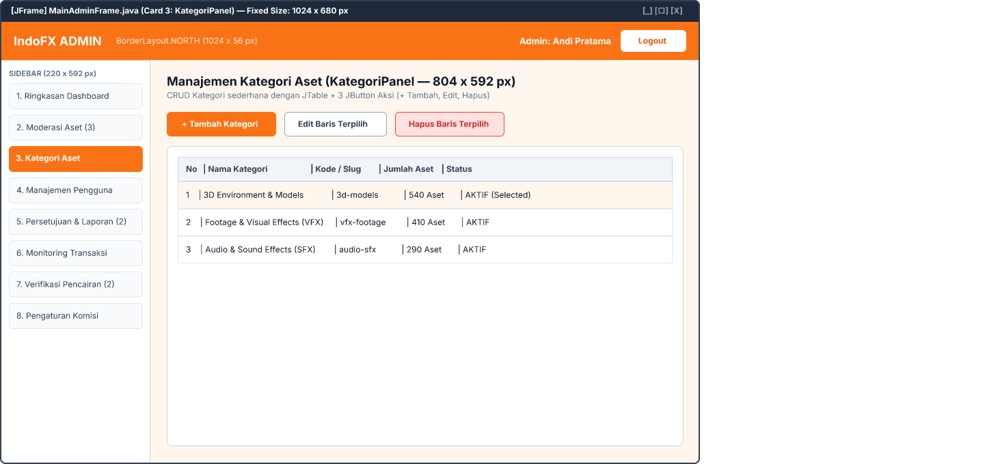

# IndoFX Admin — Aplikasi Desktop Java Swing (NetBeans Java Ant)

Repository ini adalah **base project Panel Admin IndoFX** menggunakan **Apache NetBeans (Java with Ant)** dan **Java Swing GUI Builder (Drag & Drop)** untuk dikerjakan bersama tim melalui **GitHub**.

> **Status Saat Ini:** Fokus pada **Front-End (UI Java Swing Drag & Drop)** terlebih dahulu. Logika Back-End & Database menyusul setelah seluruh halaman selesai.

---

## Daftar Isi
1. [Step-by-Step: Membuka & Menjalankan Project di NetBeans](#1-step-by-step-membuka--menjalankan-project-di-netbeans)
2. [Struktur Folder & Aturan Pembagian Tugas Tim](#2-struktur-folder--aturan-pembagian-tugas-tim)
3. [Cara Paling Cepat Buat Halaman Baru: Copy-Paste `FrmDashboard` di NetBeans](#3-cara-paling-cepat-buat-halaman-baru-copy-paste-frmdashboard-di-netbeans)
4. [Standar Ukuran Window & Palet Warna (Wajib Konsisten)](#4-standar-ukuran-window--palet-warna-wajib-konsisten)
5. [Step-by-Step: Cara Kerja Tim di GitHub (Pull, Commit, Push)](#5-step-by-step-cara-kerja-tim-di-github-pull-commit-push)
6. [Rancangan Wireframe Lengkap (Per Halaman & Pop-up)](#6-rancangan-wireframe-lengkap-per-halaman--pop-up)

---

## 1. Step-by-Step: Membuka & Menjalankan Project di NetBeans

### Langkah 1: Pastikan Software Terpasang
- **JDK** (minimal **JDK 17**; kompatibel untuk JDK 17 / 21 / 25 / 27).
- **Apache NetBeans**.

### Langkah 2: Clone Repository dari GitHub
- **Cara A (Lewat NetBeans):**
  1. Buka NetBeans → klik menu **`Team` → `Git` → `Clone...`**.
  2. Masukkan **Repository URL** GitHub tim Anda.
  3. Klik **Next** → pilih branch **`main`** → **Next** → **Finish**.
  4. Saat muncul dialog *"Clone Completed"*, klik **`Open Project`**.
- **Cara B (Lewat Terminal / GitHub Desktop):**
  ```bash
  git clone <URL_REPO_GITHUB_TIM>
  ```
  Lalu di NetBeans klik **`File` → `Open Project...`** (ikon folder dengan cangkir kopi) dan pilih folder hasil clone.

### Langkah 3: Jika Muncul Error "Broken Platform"
Jika muncul tanda seru merah karena perbedaan versi JDK di laptop Anda:
1. **Klik kanan** project **`IndoFX_Admin`** di panel kiri (*Projects*) → pilih **`Properties`**.
2. Klik **`Libraries`** → di bagian **Java Platform**, pilih JDK yang ada di laptop Anda.
3. Klik **`Sources`** → pastikan **Source/Binary Format** tetap **`JDK 17`**.
4. Klik **OK**.

### Langkah 4: Jalankan Contoh Project (`FrmDashboard`)
- Tekan **`F6`** (atau tombol **Play hijau**) untuk menjalankan project utama.
- Untuk menjalankan satu file form saja: klik kanan **`FrmDashboard.java`** → **`Run File`** (**`Shift + F6`**).

---

## 2. Struktur Folder & Aturan Pembagian Tugas Tim

Semua file form Java Swing diletakkan di dalam package **`src/indofx/admin/`**.

> **ATURAN WAJIB KERJA TIM (ANTI-BENTROK):**
> 1. **1 Orang = 1 Halaman (`Frm*`) + Pop-up-nya (`Dlg*`).** Jangan mengedit file `.java` / `.form` milik teman lain agar tidak terjadi *merge conflict*!
> 2. **Selalu Commit `.java` dan `.form` secara bersamaan.** Setiap form Drag & Drop di NetBeans memiliki sepasang file (`.java` dan `.form`). Jika salah satunya tertinggal, tab **Design** akan rusak.
> 3. **Jangan pernah commit `nbproject/private/`, `build/`, atau `dist/`.** Semuanya sudah diabaikan otomatis oleh `.gitignore`.

```text
.
├── build.xml                                # Konfigurasi build Java Ant NetBeans
├── manifest.mf                              # Manifest aplikasi Java
├── nbproject/                               # Metadata project NetBeans (jangan ubah manual)
├── docs/
│   └── wireframe/                           # Gambar Wireframe lengkap (PNG)
│       ├── full-wireframe.png               # Keseluruhan kanvas wireframe
│       ├── 00-login-dan-panduan.png
│       ├── 01-dashboard.png
│       ├── 02-moderasi-aset.png
│       ├── 03-kategori-aset.png
│       ├── 04-manajemen-pengguna.png
│       ├── 05-laporan-masalah.png
│       ├── 06-monitoring-transaksi.png
│       ├── 07-verifikasi-pencairan.png
│       └── 08-pengaturan-komisi.png
├── src/
│   └── indofx/
│       └── admin/                           # <--- LETAKKAN SEMUA FILE FORM TIM DI SINI
│           ├── Main.java                    # Entry point utama aplikasi
│           ├── FrmDashboard.java/.form      # [SUDAH JADI - TEMPLATE] Menu 1: Dashboard (1024 x 680)
│           ├── DlgQuickModerasi.java/.form  # [SUDAH JADI - TEMPLATE] Pop-up Moderasi (420 x 250)
│           ├── FrmLogin.java/.form          # (Tugas Tim) Layar Login (480 x 420)
│           ├── FrmModerasiAset.java/.form   # (Tugas Tim) Menu 2 + DlgDetailAset.java/.form
│           ├── FrmKategori.java/.form       # (Tugas Tim) Menu 3 + DlgFormKategori.java/.form
│           ├── FrmPengguna.java/.form       # (Tugas Tim) Menu 4 + DlgKelolaPengguna.java/.form
│           ├── FrmLaporan.java/.form        # (Tugas Tim) Menu 5 + DlgDetailLaporan.java/.form
│           ├── FrmTransaksi.java/.form      # (Tugas Tim) Menu 6 + DlgDetailTransaksi.java/.form
│           ├── FrmPencairan.java/.form      # (Tugas Tim) Menu 7 + DlgVerifikasiPencairan.java/.form
│           └── FrmPengaturan.java/.form     # (Tugas Tim) Menu 8: Pengaturan Komisi
└── README.md
```

---

## 3. Cara Paling Cepat Buat Halaman Baru: Copy-Paste `FrmDashboard` di NetBeans

Anda **tidak perlu membuat Navbar Oranye dan Sidebar 8 Menu dari awal!** Cukup duplikat template **`FrmDashboard`** langsung dari NetBeans:

### A. Membuat Halaman Utama (`Frm*`)
1. Di panel kiri **Projects**, klik kanan **`FrmDashboard.java`** → pilih **`Copy`** (`Ctrl + C`).
2. Klik kanan package **`indofx.admin`** → pilih **`Paste` → `Refactor Copy...`**.
3. Isi **New Name** sesuai tugas Anda (contoh: **`FrmModerasiAset`**) → klik **Refactor**.
   *(NetBeans otomatis menduplikasi file `.java` sekaligus `.form`-nya tanpa error!).*
4. Buka file baru Anda pada tab **Design**:
   - **Pindahkan highlight Oranye di Sidebar:**
     - Klik `btnMenu1` → ubah `background` menjadi abu-abu muda (`248, 250, 252`), `foreground` (`51, 65, 85`), `font` Plain `12`.
     - Klik tombol menu tugas Anda (misal `btnMenu2`) → ubah `background` menjadi Oranye (`249, 115, 22`), `foreground` Putih (`255, 255, 255`), `font` Bold `12`.
   - **Sesuaikan isi `pnlContent`:** Ubah judul, hapus/edit `pnlStats` jika tidak dipakai, ganti kolom `JTable`, dan tambahkan `JTextField` / `JComboBox` filter sesuai gambar wireframe menu Anda di bagian bawah README ini.

### B. Membuat Pop-up Dialog (`Dlg*`)
1. Klik kanan **`DlgQuickModerasi.java`** → **`Copy`**.
2. Klik kanan package **`indofx.admin`** → **`Paste` → `Refactor Copy...`** → beri nama baru (contoh: **`DlgDetailAset`** atau **`DlgVerifikasiPencairan`**).
3. Buka tab **Design**, sesuaikan ukuran `preferredSize` (`420..460 x 320..440`) dan komponen di dalam `pnlDialog` sesuai wireframe!

---

## 4. Standar Ukuran Window & Palet Warna (Wajib Konsisten)

### Standar Ukuran
| Komponen / Window | Ukuran (`Width x Height`) | Keterangan |
| :--- | :--- | :--- |
| **Window Login** (`FrmLogin`) | **`480 x 420 px`** | Card login putih di tengah (`400 x 332 px`) |
| **Window Utama Admin (Menu 1–8)** | **`1024 x 680 px`** | `resizable = false`, `Generate Center = true` |
| ↳ **Navbar Atas** (`pnlHeader`) | **`1024 x 56 px`** | `BorderLayout.NORTH` |
| ↳ **Sidebar Kiri** (`pnlSidebar`) | **`220 x 624 px`** | `BorderLayout.WEST`, 8 tombol (`195 x 38 px`) |
| ↳ **Area Konten** (`pnlContent`) | **`804 x 624 px`** | `BorderLayout.CENTER` |
| **Pop-up Detail / Form** (`Dlg*`) | **`420..460 x 250..440 px`** | `JDialog Form` (`modal = true`) |
| **Pop-up Konfirmasi** | `JOptionPane` | Untuk Konfirmasi Logout & Hapus |

### Palet Warna (RGB untuk Panel Properties NetBeans)
| Kegunaan | Hex | Nilai RGB (NetBeans) |
| :--- | :--- | :--- |
| **Oranye Utama** (Navbar, Menu Aktif, Tombol Utama) | `#F97316` | `249, 115, 22` |
| **Oranye Gelap** (Teks Logout / Aksen Angka Pending) | `#EA580C` | `234, 88, 12` |
| **Cream** (Background `pnlContent`) | `#FFF7ED` | `255, 247, 237` |
| **Putih** (Sidebar, Card, Pop-up) | `#FFFFFF` | `255, 255, 255` |
| **Abu-abu Muda** (Tombol Menu Nonaktif & Tombol Batal) | `#F8FAFC` / `#F1F5F9` | `248, 250, 252` / `241, 245, 249` |
| **Border** (Garis Kartu & Sidebar) | `#CBD5E1` | `203, 213, 225` |
| **Teks Gelap** (Judul & Isi Tabel) | `#0F172A` | `15, 23, 42` |
| **Hijau** (Tombol Setujui / Selesai) | `#16A34A` | `22, 163, 74` |
| **Merah** (Tombol Tolak / Hapus) | `#DC2626` | `220, 38, 38` |

---

## 5. Step-by-Step: Cara Kerja Tim di GitHub (Pull, Commit, Push)

### A. Sebelum Mulai Kerja (Wajib Pull!)
1. Klik kanan project `IndoFX_Admin` di NetBeans → **`Git` → `Remote` → `Pull...`**.
2. Tunggu hingga selesai agar file Anda selalu sinkron dengan update teman.

### B. Setelah Selesai Mengerjakan Halaman Anda
1. Tekan **`Shift + F11`** (*Clean and Build*) untuk memastikan tidak ada error merah.
2. Klik kanan project `IndoFX_Admin` → **`Git` → `Commit...`**.
3. Pastikan **hanya file `.java` dan `.form` tugas Anda** yang tercentang (jangan centang file teman lain).
4. Tulis pesan commit singkat (contoh: `Menambahkan FrmModerasiAset dan DlgDetailAset`) → klik **Commit**.
5. Klik kanan project → **`Git` → `Remote` → `Push...`** → ikuti hingga **Finish**.

> **Catatan Login GitHub:** Jika NetBeans meminta Password saat Push, gunakan **Personal Access Token (PAT)** GitHub, bukan password akun biasa. Alternatif lebih praktis: lakukan Pull/Commit/Push memakai **GitHub Desktop**, sementara ngoding & drag-and-drop tetap di **NetBeans**.

---

## 6. Rancangan Wireframe Lengkap (Per Halaman & Pop-up)

* **Lihat Gambar Keseluruhan Kanvas:** [`docs/wireframe/full-wireframe.png`](docs/wireframe/full-wireframe.png)

### 0. Layar Login (`FrmLogin` — `480 x 420 px`) & Konfirmasi Logout (`JOptionPane`)


---

### 1. Menu 1 — Ringkasan Dashboard (`FrmDashboard` & `DlgQuickModerasi` — *SUDAH JADI*)
* **Window Utama:** `1024 x 680 px` (4 Kartu Statistik + `JTable` Antrean Moderasi Terbaru)
* **Pop-up (`JDialog`):** `420 x 250 px` (Konfirmasi Cepat Moderasi)


---

### 2. Menu 2 — Moderasi & Persetujuan Aset (`FrmModerasiAset` & `DlgDetailAset`)
* **Penyederhanaan:** **Tidak pindah halaman & tanpa galeri gambar.** Klik tombol `[Tinjau & Approve (Pop-up)]` di atas tabel langsung membuka 1 `JDialog`.
* **Window Utama:** `1024 x 680 px` (Filter Bar + `JTable`)
* **Pop-up (`JDialog`):** `460 x 440 px` (Info Teks Detail Aset + `JTextArea` Catatan/Alasan Penolakan + Tombol Batal / Tolak / Setujui)


---

### 3. Menu 3 — Manajemen Kategori Aset (`FrmKategori` & `DlgFormKategori`)
* **Window Utama:** `1024 x 680 px` (3 Tombol Aksi: `[+ Tambah]`, `[Edit]`, `[Hapus]` + `JTable`)
* **Pop-up Form (`JDialog`):** `420 x 320 px` (`JTextField` Nama Kategori, Kode/Slug, `JComboBox` Status)
* **Pop-up Hapus:** `JOptionPane.showConfirmDialog`


---

### 4. Menu 4 — Manajemen Pengguna & Kreator (`FrmPengguna` & `DlgKelolaPengguna`)
* **Window Utama:** `1024 x 680 px` (4 Kartu Statistik + Filter Bar + `JTable`)
* **Pop-up (`JDialog`):** `420 x 340 px` (Info Nama & Email + `JComboBox` Role & Status Akun Aktif/Suspended)


---

### 5. Menu 5 — Persetujuan Pengajuan & Laporan Masalah (`FrmLaporan` & `DlgDetailLaporan`)
* **Window Utama:** `1024 x 680 px` (Filter Bar + `JTable` Daftar Tiket Laporan)
* **Pop-up (`JDialog`):** `460 x 380 px` (Detail Tiket & Keluhan + `JTextArea` Solusi Admin + Tombol Batal / Tolak / Tandai Selesai)


---

### 6. Menu 6 — Monitoring Transaksi & Komisi (`FrmTransaksi` & `DlgDetailTransaksi`)
* **Window Utama:** `1024 x 680 px` (4 Kartu Statistik Pendapatan + Filter Bar + `JTable`)
* **Pop-up (`JDialog`):** `440 x 340 px` (Rincian Teks Harga Aset, Potongan Komisi 10%, dan Pendapatan Bersih Kreator)


---

### 7. Menu 7 — Verifikasi Pencairan Dana Kreator (`FrmPencairan` & `DlgVerifikasiPencairan`)
* **Penyederhanaan:** **Tanpa upload file gambar bukti invoice transfer.**
* **Window Utama:** `1024 x 680 px` (Filter Bar + `JTable` Pengajuan Pencairan)
* **Pop-up (`JDialog`):** `460 x 380 px` (Info Kreator, Bank & No. Rekening, Nominal + `JTextField` No. Referensi Transfer / Catatan + Tombol Batal / Tolak / Konfirmasi Selesai)


---

### 8. Menu 8 — Pengaturan Sistem & Komisi Platform (`FrmPengaturan`)
* **Window Utama:** `1024 x 680 px` (2 `JPanel` berdampingan: Card Kiri form `% Komisi`, `Minimum Pencairan`, `Catatan Kebijakan` + tombol `[Simpan]`; Card Kanan ringkasan aturan aktif).

